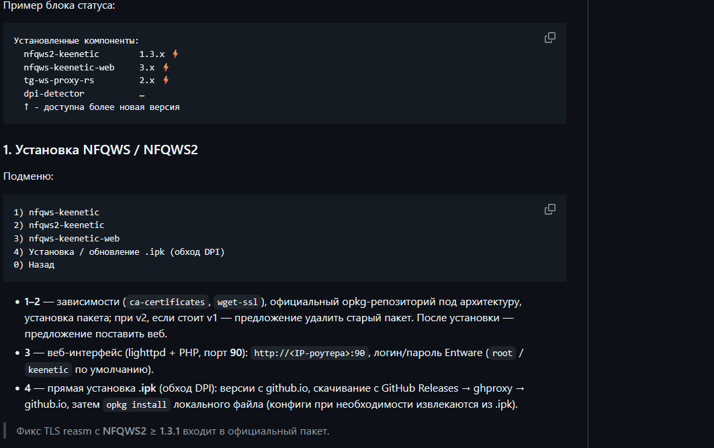
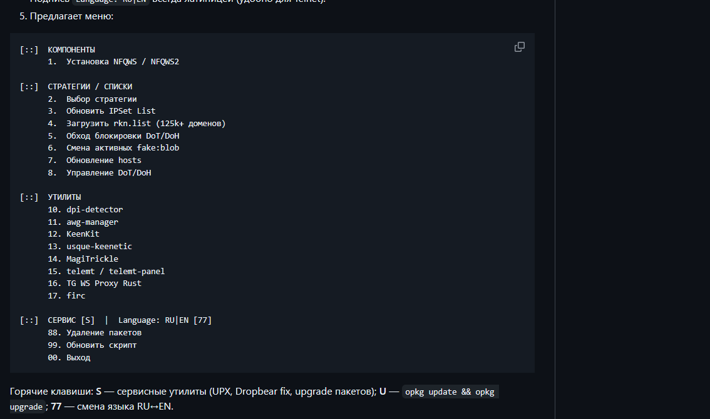

<div align="center">

# ◆ Xmenu

**Консольное меню для установки и обслуживания компонентов Keenetic / Netcraze с Entware**

XKeen · Xray / Mihomo · NFQWS / NFQWS2 · стратегии · OPKG · диагностика


</div>

## Быстрый старт

Подключись к роутеру по SSH под `root`. Нужны Entware в `/opt`, `curl` и рабочая сеть. Каждый блок ниже — самостоятельный способ загрузить один и тот же скрипт.

### 1. GitHub Raw — основной адрес

```sh
mkdir -p /opt/bin && curl -fL --retry 3 'https://raw.githubusercontent.com/rangerxxyy/Xmenu/main/xmenu-v1.0.sh' -o /tmp/xmenu.sh && sh -n /tmp/xmenu.sh && { [ ! -f /opt/bin/xmenu ] || cp -p /opt/bin/xmenu "/opt/bin/xmenu.bak.$(date +%Y%m%d-%H%M%S)"; } && cp /tmp/xmenu.sh /opt/bin/xmenu && chmod 700 /opt/bin/xmenu && /opt/bin/xmenu
```

### 2. GitHub Raw через `wget`

```sh
mkdir -p /opt/bin && wget -O /tmp/xmenu.sh 'https://raw.githubusercontent.com/rangerxxyy/Xmenu/main/xmenu-v1.0.sh' && sh -n /tmp/xmenu.sh && { [ ! -f /opt/bin/xmenu ] || cp -p /opt/bin/xmenu "/opt/bin/xmenu.bak.$(date +%Y%m%d-%H%M%S)"; } && cp /tmp/xmenu.sh /opt/bin/xmenu && chmod 700 /opt/bin/xmenu && /opt/bin/xmenu
```

### 3. jsDelivr — зеркало GitHub

```sh
mkdir -p /opt/bin && curl -fL --retry 3 'https://cdn.jsdelivr.net/gh/rangerxxyy/Xmenu@main/xmenu-v1.0.sh' -o /tmp/xmenu.sh && sh -n /tmp/xmenu.sh && { [ ! -f /opt/bin/xmenu ] || cp -p /opt/bin/xmenu "/opt/bin/xmenu.bak.$(date +%Y%m%d-%H%M%S)"; } && cp /tmp/xmenu.sh /opt/bin/xmenu && chmod 700 /opt/bin/xmenu && /opt/bin/xmenu
```

Каждая команда сначала проверяет синтаксис загруженного скрипта, затем сохраняет прежний `/opt/bin/xmenu` и запускает новую копию. Для способов 1, 3 и 4 нужен `curl`; если он не установлен, выполни `opkg update && opkg install curl`. Для способа 2 нужен `wget`. При проблеме с одним адресом попробуй следующий.

После установки меню открывается командой:

```sh
xmenu
```

Обновление установленной копии: выбери **22 — «Обновить Xmenu»** или выполни `xmenu update-xmenu`.

## Содержание

- [Возможности](#возможности)
- [Требования](#требования)
- [Главное меню](#главное-меню)
- [Стратегии NFQWS и списки](#стратегии-nfqws-и-списки)
- [Репозитории Entware и OPKG](#репозитории-entware-и-opkg)
- [Удаление и резервные копии](#удаление-и-резервные-копии)
- [Команды](#команды)
- [Файлы проекта и данные роутера](#файлы-проекта-и-данные-роутера)
- [Проверка и сообщения об ошибках](#проверка-и-сообщения-об-ошибках)
- [Зависимые проекты](#зависимые-проекты)
- [История изменений](#история-изменений)

## Возможности

Xmenu объединяет установщики и повседневные действия для роутеров Keenetic / Netcraze. Сам скрипт — интерфейс управления: компоненты и сетевые утилиты принадлежат своим проектам и устанавливаются их штатными пакетами или установщиками.

| Раздел | Что доступно |
|---|---|
| **Установка** | XKeen Stable, XKeen UI, nfqws2, nfqws-web-keenetic, nfqws2-ui и готовые профили с Xray или Mihomo. |
| **NFQWS** | Выбор стратегии, проверка и загрузка нужных blobs/lists, установка blobs NFQWS2 и загрузка `rkn.list`. |
| **Утилиты** | DPI Detector, TG WS Proxy Rust, KeenKit и awg-manager. Некоторые действия выполняются через проверенную временную копию `nfqws-menu`. |
| **Entware / OPKG** | Автоматический поиск доступного зеркала, проверка индексов, ручное переключение, восстановление `opkg.conf` и `opkg update`. |
| **Обслуживание** | Удаление выбранных компонентов, очистка резервных файлов и blobs, диагностика и смена языка RU / EN. |

В верхней части меню отображаются модель, KeeneticOS, архитектура и найденные компоненты. Проверка обновления Xmenu выполняется в фоне; доступное обновление показывается бирюзовой строкой под пунктом `U`.

### Пример блока состояния `nfqws-menu`

На изображении показано отдельное связанное меню `nfqws-menu`, которое Xmenu использует для некоторых утилит. Это пример его блока состояния и экрана установки, а не снимок главного меню Xmenu.



## Требования

- Keenetic / Netcraze с интерактивным доступом по SSH.
- Установленный Entware в `/opt` и команда `opkg`.
- Права `root` для установки и изменения файлов.
- Достаточное место в `/opt` для пакетов, кэша и резервных копий.
- Доступ к выбранным GitHub-зеркалам и репозиториям пакетов для сетевых действий.
- Совместимые с прошивкой модули Netfilter для работы самих NFQWS/NFQWS2 пакетов, если этого требует выбранный пакет.

Xmenu не устанавливает Entware и модули ядра автоматически. Совместимость, доступность функций и требования к модулям зависят от прошивки, архитектуры и конкретного компонента.

## Главное меню

Нумерация относится к Xmenu v1.3.3. Пустые строки разделяют группы; номера остаются постоянными.

```text
[::]  Установка / обновление:
  1–6   Отдельные компоненты

[::]  Ручные настройки установки:
  7–10  Профили XKeen с Mihomo или Xray

[::]  Стратегии / blobs / lists:
  11    Выбор стратегии nfqws
  12    Проверка ресурсов активной стратегии
  13    Установка blobs nfqws2
  14    Загрузка rkn.list

[::]  Утилиты и диагностика:
  15–18 DPI Detector, TG WS Proxy Rust, KeenKit, awg-manager

[::]  Обслуживание и настройки:
  19    Сменить язык: RU / EN (change language)
  20    Удаление утилит и компонентов
  21    Удалить Xmenu
  22    Обновить Xmenu
  23    Настройки OPKG / зеркала Entware
  0     Выход
```

Пример компоновки другого связанного инструмента `nfqws-menu` приведён ниже. Он показывает группировку пунктов и отступы; интерфейс Xmenu имеет собственную нумерацию и набор разделов.



`U` в приглашении меню запускает немедленную проверку новой версии Xmenu. Она не устанавливает обновление: для установки выбери пункт **22**. В главном меню Xmenu можно одновременно работать из нескольких SSH-сессий; одновременная запись настроек сериализуется на время операции.

## Стратегии NFQWS и списки

Пункт **11** показывает стратегии из локального кэша для установленного `nfqws-keenetic` или `nfqws2-keenetic`. Названия выровнены по номеру; активная стратегия выделяется яркой бирюзой.

При выборе стратегия загружается или берётся из кэша, сверяется по SHA256, после подтверждения сохраняется копия действующей конфигурации и применяются необходимые ресурсы. При ошибке проверки файл не применяется. После успешной замены Xmenu перезапускает соответствующую службу.

Другие действия раздела:

- **12** проверяет ресурсы, на которые ссылается активная стратегия; это не меняет выбранную стратегию.
- **13** устанавливает файлы blobs NFQWS2 в `/opt/etc/nfqws2/blobs/`.
- **14** загружает большой список `rkn.list` и при необходимости добавляет ссылку на него в конфигурацию.

Основные конфиги расположены в `/opt/etc/nfqws/nfqws.conf` и `/opt/etc/nfqws2/nfqws2.conf`. NFQWS v1 и NFQWS2 используют разные каталоги и службы; не переносите конфиги и blobs между ними вручную.

## Репозитории Entware и OPKG

Открой **23 — «Настройки OPKG / зеркала Entware»**. Заголовок раздела выделен бирюзовым.

1. **Авто-выбор доступного репозитория Entware** — проверяет зеркало и автоматически выбирает доступный источник с лучшим временем ответа.
2. **Проверить доступность зеркал Entware** — показывает состояние, регион и адрес каталогов.
3. **Выбрать зеркало Entware вручную** — показывает каталог и помечает текущее зеркало; при входе и выборе сеть не тестируется.
4. **Восстановить копию `opkg.conf`** — вернуть последнюю копию, созданную Xmenu.
5. **Выполнить `opkg update`** — обновить индексы пакетов.

Проверка зеркала загружает `Packages.gz` и проверяет содержимое индекса. HTML-страницы блокировки и повреждённые архивы считаются ошибкой даже при успешном HTTP-ответе. Перед сменой зеркала Xmenu сохраняет конфигурацию в `/opt/etc/xmenu/backups/`; сторонние источники в `opkg.conf` не перезаписываются.

## Удаление и резервные копии

Пункт **20 — «Удаление утилит и компонентов»** имеет постоянные номера:

```text
1.  XKeen — полная деинсталляция
2.  XKeen UI — zxc-rv
3.  DPI Detector
4.  nfqws2-keenetic
5.  nfqws-keenetic-web
6.  Mihomo
7.  Удалить все пакеты NFQWS
8.  Удалить резервные копии (*.bak, *.bak.* / *-opkg)
9.  Удалить все blobs NFQWS2 (*.bin)
10. Удалить все бэкапы Xmenu (включая копии конфигураций)
11. Другие установленные компоненты
0.  Назад
```

Пункт 8 сканирует `/opt/etc/nfqws`, `/opt/etc/nfqws2`, `/opt/etc/xkeen`, `/opt/etc/lighttpd` и `/opt/etc/xmenu/backups`. Перед подтверждением Xmenu перечисляет найденные файлы `*.bak`, `*.bak.*` и `*-opkg`. Основные файлы конфигураций в эти маски не входят.

Пункт 9 удаляет только `*.bin` непосредственно из каталога blobs NFQWS2. Пункт 10 удаляет резервные копии самого Xmenu и содержимое каталога резервных данных, включая архивы конфигураций; действующий скрипт сохраняется. Удаление компонентов требует подтверждения. Некоторые сторонние деинсталляторы могут иметь собственные правила сохранения конфигураций.

Резервный архив конфигураций создаётся командой `xmenu backup`. Пункт 24 главного меню удалён; сама команда сохранена для тех, кому нужно вручную создать архив.

## Команды

```sh
xmenu                 # открыть меню
xmenu status          # вывести сведения об устройстве и компонентах
xmenu update-xmenu    # обновить сам Xmenu
xmenu strategies      # открыть выбор стратегии
xmenu sync            # синхронизировать ресурсы активной стратегии
xmenu opkg-settings   # открыть настройки Entware / OPKG
xmenu backup          # создать архив конфигураций
```

Команды с подменю рассчитаны на интерактивный терминал. Для открытия установленной копии напрямую используй `/opt/bin/xmenu`.

## Файлы проекта и данные роутера

```text
Репозиторий
├── xmenu-v1.0.sh                 основной POSIX sh / BusyBox ash скрипт
├── README.md                     установка и справочник пользователя
├── CHANGELOG.md                  история изменений
├── docs/images/                  примеры интерфейса nfqws-menu
│   ├── nfqws-menu-status-example.png
│   └── nfqws-menu-layout-example.png
├── tests/regression.sh           сценарии регрессии с временными конфигами
├── tests/menu_input.py           проверка ввода в PTY
└── .github/workflows/             CI: синтаксис, ShellCheck и регрессии
```

На роутере:

| Путь | Назначение |
|---|---|
| `/opt/bin/xmenu` | установленный скрипт |
| `/opt/etc/xmenu/` | кэш, язык и данные Xmenu |
| `/opt/etc/xmenu/backups/` | архивы и копии конфигураций |
| `/opt/etc/xmenu/language` | язык интерфейса `ru` или `en` |
| `/opt/etc/opkg.conf` | источники пакетов Entware |
| `/opt/etc/nfqws/nfqws.conf` | конфигурация NFQWS v1 |
| `/opt/etc/nfqws2/nfqws2.conf` | конфигурация NFQWS2 |

## Проверка и сообщения об ошибках

В репозитории настроены `sh -n`, ShellCheck, сценарии регрессии под BusyBox ash и тест интерактивного ввода через PTY. Для локальной проверки на Linux:

```sh
sh -n xmenu-v1.0.sh
shellcheck -s sh -S warning xmenu-v1.0.sh
busybox ash tests/regression.sh
python3 tests/menu_input.py
```

Если загрузка или `opkg update` не проходит, сначала проверь сеть и DNS. Для проблемы с пакетом полезен вывод `opkg print-architecture`; для ошибки Xmenu приложи выбранный пункт и полный текст сообщения. Перед отправкой логов удали пароли, токены и приватные ключи.

## Зависимые проекты

Xmenu вызывает компоненты и скрипты их авторов. Проверяй актуальные требования и лицензии в соответствующих репозиториях:

- [XKeen](https://github.com/jameszeroX/XKeen), [XKeen UI zxc-rv](https://github.com/zxc-rv/XKeen-UI), [XKeen UI umarcheh001](https://github.com/umarcheh001/Xkeen-UI)
- [nfqws-menu](https://github.com/rndnaame/nfqws-menu), [nfqws2-keenetic](https://github.com/nfqws/nfqws2-keenetic), [nfqws-keenetic-web](https://github.com/nfqws/nfqws-keenetic-web), [nfqws2-ui](https://github.com/zemidala/nfqws2-ui)
- [DPI Detector](https://github.com/Runnin4ik/dpi-detector), [TG WS Proxy Rust](https://github.com/valnesfjord/tg-ws-proxy-rs), [KeenKit](https://github.com/spatiumstas/KeenKit)

## История изменений

- **v1.3.3** — проверка зеркал по индексу `Packages.gz`, безопасный авто-выбор Entware, одновременные SSH-сессии и исправления фоновых обновлений. После релиза в `main` уточнены меню и README.
- **v1.3.2** — авто-подбор зеркала по доступности, обновлённая OPKG-конфигурация и исправления проверки обновления Xmenu.
- **v1.3.1** — проверка доступности зеркал Entware и обработка результата проверки.
- **v1.3.0** — обновление статуса компонентов, загрузки через `wget`, начальная установка и работа со стратегиями NFQWS.

Подробности — в [CHANGELOG.md](CHANGELOG.md) и [странице релизов](https://github.com/rangerxxyy/Xmenu/releases).

## Лицензия

В репозитории пока нет файла `LICENSE`, поэтому лицензия проекта не объявлена. Условия сторонних компонентов определяются их авторами.
